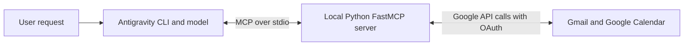

# Assignment 3 - Gmail and Google Calendar via MCP

This project connects an AI agent in Antigravity CLI (`agy`) to a dedicated coursework Google account. A local Python MCP server exposes six tools for searching and reading email, saving drafts, checking calendar availability, and creating personal events. The model in the CLI interprets a natural-language request and chooses which tools to call.

The project builds on the L05 exercise: use Google APIs to create a Gmail draft and a calendar event four hours from the request. Following L06, those API operations are exposed through an MCP server so the agent can use them for different requests without generating a new Python script each time.

## How it works



The language model runs through the CLI host. The server contains the Google API operations and does not run a language model itself. Google sign-in takes place separately in the browser through the authorization command.

| Tool | What it does |
| --- | --- |
| `search_emails` | Searches Gmail and returns message IDs, senders, subjects, and snippets. |
| `read_email` | Reads a message by ID and returns its headers and decoded body. |
| `create_draft` | Saves an email draft, with optional CC and BCC, for human review. |
| `list_events` | Lists primary-calendar events within a supplied time range. |
| `find_free_slots` | Finds free intervals and possible slots of a requested duration. |
| `create_event` | Creates an event on the primary calendar without attendees. |

There is no send, forward, or delete tool. The account owner reviews drafts and sends them manually in Gmail. Event creation does not check for conflicts automatically; the agent must check availability first when the request requires it. All calendar tools use `Asia/Jerusalem`.

## Run on Windows

You need PowerShell, Git, Python 3.12 or later, uv, Antigravity CLI (`agy`), and a Google account authorized to test your OAuth app. The project pins Python 3.12 in `.python-version`.

As in L05, enable the Gmail and Google Calendar APIs in your Google Cloud project, configure the OAuth consent screen, and add the coursework account as a test user if the app is in Testing mode. Download the **Desktop app** OAuth client JSON into a private directory outside the checkout. Exactly one filename in that directory must match `client_secret*.json`. If your L05 download is named `credentials.json`, rename that private file to `client_secret.json` for this implementation.

### 1. Install and authorize

```powershell
git clone https://github.com/yonti32-ux/-polsci01-assignment-3-.git assignment-3
cd assignment-3
uv sync --locked
$env:GOOGLE_PRIVATE_DIR = Read-Host 'Full path of your private OAuth directory'
$env:CLASS_EMAIL = Read-Host 'Google email address for this project'
uv run auth --expected-email $env:CLASS_EMAIL
```

For a new authorization, choose that account in the browser. A successful profile check saves `token.json` beside the client JSON in the private directory. The authorization command can reuse a suitable existing token. If it reports an expired or revoked authorization, missing permissions, or an account mismatch, authorize again with:

```powershell
uv run auth --expected-email $env:CLASS_EMAIL --overwrite
```

This implementation checks for the four scopes listed in [PRD.md](PRD.md#account-access-and-operating-constraints). An older L05 token may require authorization again. The MCP server does not open a sign-in browser itself.

### 2. Connect Antigravity CLI

From the same PowerShell session in the project root, run the following once for a fresh checkout. It creates a machine-local configuration containing the Python executable path, the private directory path, and the expected email address. If you already have a project MCP configuration, merge the `gmail-calendar` entry into it.

```powershell
$mcpPython = (Resolve-Path '.\.venv\Scripts\python.exe').Path
$mcpConfig = @{ mcpServers = @{ 'gmail-calendar' = @{
    command = $mcpPython
    args = @('-m', 'gmail_calendar.server')
    env = @{
        GOOGLE_PRIVATE_DIR = $env:GOOGLE_PRIVATE_DIR
        CLASS_EMAIL = $env:CLASS_EMAIL
    }
} } }
New-Item -ItemType Directory -Force .agents | Out-Null
$mcpConfigPath = Join-Path $PWD '.agents\mcp_config.json'
if (Test-Path $mcpConfigPath) { throw 'MCP config exists. Merge the server entry manually.' }
[IO.File]::WriteAllText($mcpConfigPath, ($mcpConfig | ConvertTo-Json -Depth 6))
agy
```

Inside Antigravity, enter `/mcp` and check that `gmail-calendar` is connected with six tools. Restart the CLI if a newly added configuration has not loaded. For subsequent sessions on the configured laptop, open the project directory and run `agy`; the local configuration retains the server's environment values. If the checkout moves, recreate or update its absolute Python path.

The `.agents/mcp_config.json` file is excluded from Git because its paths and account settings belong to that machine. Keep the OAuth client JSON and `token.json` in the private directory as well.

### 3. Verify the L05 task through MCP

First ask a read-only question:

```text
Use the gmail-calendar MCP tools only. What is in my primary
calendar tomorrow? Use Asia/Jerusalem time.
```

Expand the `list_events` call and compare the response with Google Calendar. An empty list is a valid result when no events are scheduled.

Then ask for the exercise result:

```text
Use the gmail-calendar MCP tools only; do not write or run a new script.
Create a Gmail draft addressed to my configured coursework account,
with subject "L06 test" and body "Testing Gmail and Calendar through MCP."
Also create a 30-minute personal calendar event called "MCP works",
starting four hours from the current time in Asia/Jerusalem.
Do not send any email or invite anyone.
```

Check that the CLI invoked `create_draft` and `create_event`, open Gmail > Drafts to verify the unsent draft, and open Google Calendar to verify the event's title and time. If the account address is unclear to the agent, supply it explicitly. The 30-minute duration makes the example's end time explicit.

These are usage examples for verification, not a record of the development prompts.

## Using the other tools

For example, ask the agent to find a free hour tomorrow between 09:00 and 17:00, check the result, and create a personal event there. It can call `find_free_slots` followed by `create_event`. For email, ask it to search for a known message, read the returned ID, and prepare a draft reply for review.

The calendar tools accept `start_time` and `end_time` as ISO date/time strings, such as `2026-11-25T09:00:00+02:00`. The agent translates requests such as "tomorrow" into those values. Unlike the example signatures in the lecture, this implementation uses explicit time windows rather than `days_ahead` or a single `date` argument.

## Project files

```text
src/gmail_calendar/
  server.py          MCP tool definitions and stdio entry point
  gmail_ops.py       Gmail API operations
  calendar_ops.py    Calendar API operations
  auth.py           Manual OAuth and credential loading
  config.py         Private paths, account setting, and scopes
  timezone_utils.py Date parsing and free-interval calculations
tests/               Automated tests using temporary or mocked data
PRD.md               Product scope and acceptance criteria
pyproject.toml       Python dependencies and entry points
uv.lock              Locked dependency versions
```

## Run the tests

```powershell
uv run python -m pytest -v
```

The suite uses mocked Google responses and temporary credentials. It also exercises the MCP handshake and tool discovery in a subprocess. It does not sign in to the coursework account or prove that a live draft or event was created.

The integration was tested successfully during the L06 class on **24 November 2026**, on the laptop configured with the dedicated coursework account, as confirmed by the project owner. Screenshots of that live run are not included in this checkout. See [PRD.md](PRD.md) for the recorded live Calendar read, implemented requirements, test coverage, and manual acceptance procedure.
